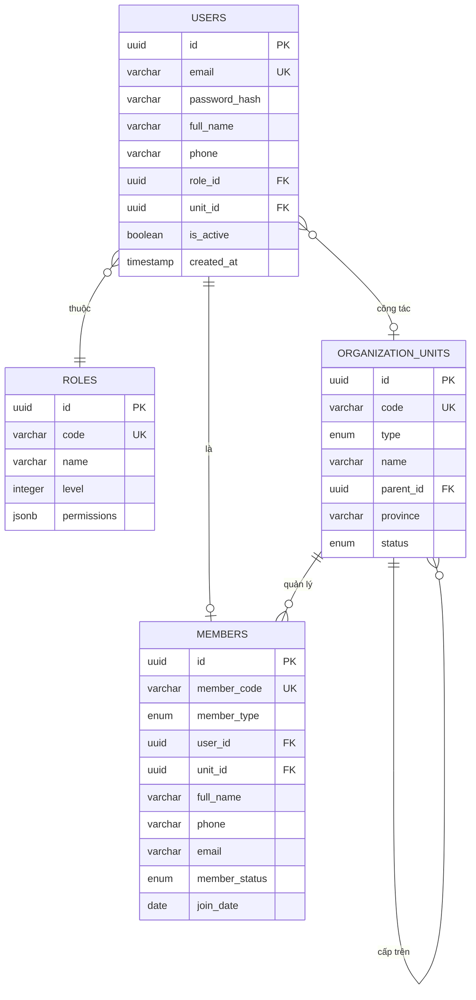
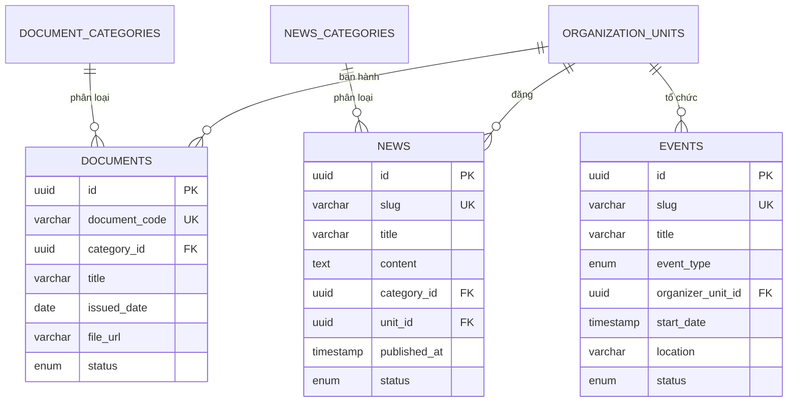
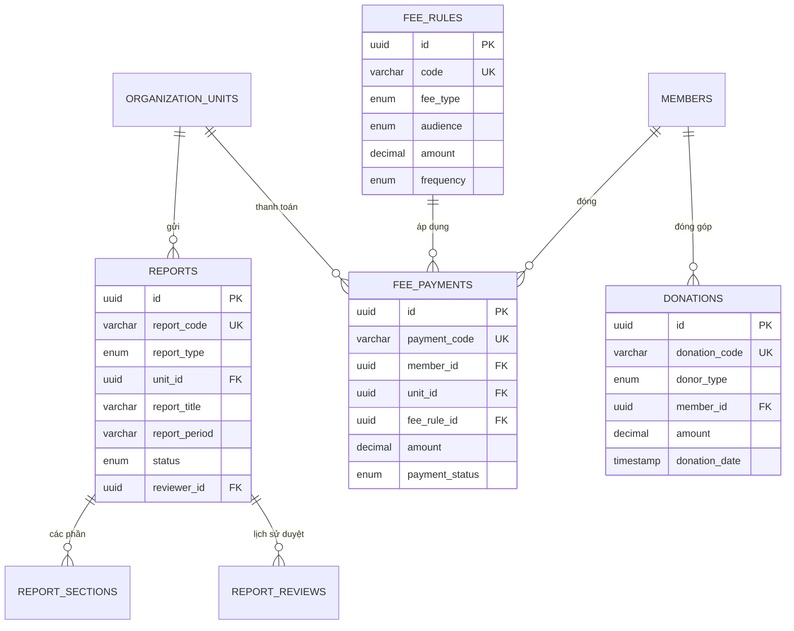
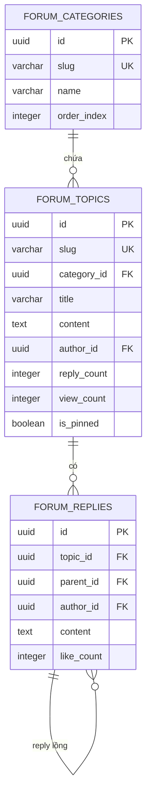

# Đặc tả Cơ sở dữ liệu – Website Hội GDCSSKCĐ Việt Nam

> **Phiên bản:** 1.0.0  
> **Ngày tạo:** 2025  
> **Đơn vị chủ quản:** Hội GDCSSKCĐ Việt Nam  
> **Mục đích:** Mô tả chi tiết các bảng CSDL phục vụ triển khai backend

---

## 📖 Mục lục

| # | File | Nội dung |
|---|---|---|
| 01 | [01-users.md](./01-users.md) | Người dùng & Phân quyền |
| 02 | [02-leadership.md](./02-leadership.md) | Ban Chấp hành, Ban Thường vụ, Lãnh đạo đơn vị |
| 03 | [03-organization.md](./03-organization.md) | Hệ thống tổ chức (6 loại đơn vị) |
| 04 | [04-members.md](./04-members.md) | Hội viên cá nhân & tổ chức |
| 05 | [05-documents.md](./05-documents.md) | Văn bản, Điều lệ, Quy định |
| 06 | [06-news-events.md](./06-news-events.md) | Tin tức, Sự kiện |
| 07 | [07-reports.md](./07-reports.md) | Báo cáo gửi TW Hội |
| 08 | [08-fees.md](./08-fees.md) | Phí, Hội phí, Đóng góp |
| 09 | [09-forum.md](./09-forum.md) | Diễn đàn cộng đồng |
| 10 | [10-media.md](./10-media.md) | Media (ảnh, video, file) |

---

## 📌 Đối chiếu với yêu cầu Ban tổ chức

| Mục | Yêu cầu | Bảng CSDL tương ứng |
|---|---|---|
| I.1.b | Ban lãnh đạo Hội (Thường trực) | `executive_board`, `standing_committee` |
| I.2 | Văn bản quan trọng | `documents` |
| II | Tin tức, sự kiện | `news`, `events` |
| III.1-4 | Quy định thành lập, giải thể | `documents` |
| III.5.a-f | CSDL 6 loại đơn vị tổ chức | `organization_units` + 6 bảng con |
| III.6 | Chế độ báo cáo | `reports`, `report_sections` |
| IV.1 | Ban Chấp hành TW Hội | `executive_board` |
| IV.2 | Ban Thường vụ TW Hội | `standing_committee` |
| IV.3 | Lãnh đạo các đơn vị | `unit_leaders` |
| IV.4 | Hội viên | `members` |
| IV.5 | Đại hội, bầu cử | `congress`, `documents` |
| IV.6 | Bổ nhiệm cán bộ | `appointments` |
| V.1 | Phí, hội phí | `fee_rules` |
| V.2 | Đóng phí trực tuyến | `fee_payments`, `payment_reminders` |
| V.3 | Đóng góp từ thiện | `donations` |

---

## 🏗️ Sơ đồ quan hệ thực thể (ERD)

### ERD tổng quan

```mermaid
erDiagram
    USERS ||--o{ MEMBERS : "có tài khoản"
    USERS ||--o{ DOCUMENTS : "tạo"
    USERS ||--o{ NEWS : "đăng"
    USERS ||--o{ REPORTS : "gửi"
    USERS ||--o{ FILES : "upload"
    USERS }o--|| ROLES : "thuộc"
    USERS }o--o| ORGANIZATION_UNITS : "công tác tại"

    ROLES ||--o{ USERS : "gán cho"

    ORGANIZATION_UNITS ||--o{ ORGANIZATION_UNITS : "cấp trên"
    ORGANIZATION_UNITS ||--o{ MEMBERS : "quản lý"
    ORGANIZATION_UNITS ||--o{ DOCUMENTS : "ban hành"
    ORGANIZATION_UNITS ||--o{ NEWS : "đăng"
    ORGANIZATION_UNITS ||--o{ EVENTS : "tổ chức"
    ORGANIZATION_UNITS ||--o{ REPORTS : "gửi"
    ORGANIZATION_UNITS ||--o{ UNIT_LEADERS : "có lãnh đạo"
    ORGANIZATION_UNITS ||--o{ FEE_PAYMENTS : "thanh toán"
    ORGANIZATION_UNITS ||--o{ PAYMENT_REMINDERS : "nhắc nhở"

    TERMS ||--o{ EXECUTIVE_BOARD : "nhiệm kỳ"
    TERMS ||--o{ STANDING_COMMITTEE : "nhiệm kỳ"
    TERMS ||--o{ UNIT_LEADERS : "nhiệm kỳ"

    MEMBERS ||--o{ FEE_PAYMENTS : "đóng"
    MEMBERS ||--o{ PAYMENT_REMINDERS : "nhận"
    MEMBERS ||--o{ DONATIONS : "đóng góp"
    MEMBERS ||--o| MEMBER_CARDS : "được cấp"
    MEMBERS ||--o{ EVENT_REGISTRATIONS : "đăng ký"

    DOCUMENT_CATEGORIES ||--o{ DOCUMENTS : "phân loại"
    DOCUMENTS ||--o{ DOCUMENT_VERSIONS : "phiên bản"
    DOCUMENTS ||--o{ DOCUMENT_VIEWS : "lượt xem"

    NEWS_CATEGORIES ||--o{ NEWS : "phân loại"
    NEWS ||--o{ NEWS_COMMENTS : "bình luận"

    EVENTS ||--o{ EVENT_REGISTRATIONS : "đăng ký"

    REPORTS ||--o{ REPORT_SECTIONS : "các phần"
    REPORTS ||--o{ REPORT_ATTACHMENTS : "file"
    REPORTS ||--o{ REPORT_REVIEWS : "lịch sử duyệt"

    FEE_RULES ||--o{ FEE_PAYMENTS : "áp dụng"
    FEE_RULES ||--o{ PAYMENT_REMINDERS : "áp dụng"

    DONATION_CAMPAIGNS ||--o{ DONATIONS : "chiến dịch"

    FORUM_CATEGORIES ||--o{ FORUM_TOPICS : "chứa"
    FORUM_TOPICS ||--o{ FORUM_REPLIES : "có"
    FORUM_REPLIES ||--o{ FORUM_REPLIES : "reply lồng"

    FILES ||--o{ GALLERY_ITEMS : "chứa"
    GALLERY_ALBUMS ||--o{ GALLERY_ITEMS : "album"
```

### ERD – Nhóm Người dùng & Tổ chức

### ERD – Nhóm Nội dung

### ERD – Nhóm Báo cáo & Phí

### ERD – Nhóm Diễn đàn

---

## 🎯 Quy ước chung

### Đặt tên

| Loại | Quy ước | Ví dụ |
|---|---|---|
| **Bảng** | snake_case, số nhiều | `members`, `documents` |
| **Cột** | snake_case | `created_at`, `full_name` |
| **Khóa chính** | `id` | |
| **Khóa ngoại** | `<singular>_id` | `member_id`, `unit_id` |
| **Boolean** | prefix `is_` hoặc `has_` | `is_active`, `has_signed` |
| **Timestamp** | suffix `_at` | `created_at`, `updated_at` |
| **Date** | suffix `_date` | `issued_date`, `submit_date` |

### Kiểu dữ liệu

| Kiểu | Mô tả | Ví dụ |
|---|---|---|
| `UUID` | Khóa chính, ID toàn cầu | `a1b2c3d4-...` |
| `VARCHAR(n)` | Chuỗi tối đa n ký tự | `VARCHAR(255)` |
| `TEXT` | Chuỗi dài không giới hạn | Nội dung bài viết |
| `INTEGER` | Số nguyên | `10`, `500` |
| `DECIMAL(p,s)` | Số thập phân | `DECIMAL(15,2)` cho tiền |
| `BOOLEAN` | Đúng/sai | `true`, `false` |
| `DATE` | Ngày | `2025-12-20` |
| `TIMESTAMP` | Ngày + giờ | `2025-12-20 14:30:00` |
| `ENUM` | Tập giá trị cố định | `'draft'`, `'approved'` |
| `JSONB` | Dữ liệu JSON (PostgreSQL) | Mảng, object |

### Trường audit (bắt buộc mọi bảng)

| Trường | Kiểu | Mô tả |
|---|---|---|
| `id` | UUID | Khóa chính |
| `created_at` | TIMESTAMP | Ngày tạo (default NOW()) |
| `updated_at` | TIMESTAMP | Ngày cập nhật cuối |
| `created_by` | UUID | Người tạo (FK → users.id) |
| `updated_by` | UUID | Người cập nhật cuối (FK → users.id) |
| `deleted_at` | TIMESTAMP | Soft delete (NULL = chưa xóa) |

### Quan hệ

| Ký hiệu | Ý nghĩa |
|---|---|
| 1–1 | Một-một |
| 1–N | Một-nhiều |
| N–N | Nhiều-nhiều (cần bảng trung gian) |

---

## 🚀 Chiến lược triển khai

### Giai đoạn 1 – MVP (Minimum Viable Product)
- `users`, `roles`
- `members`
- `organization_units`
- `documents`
- `news`

### Giai đoạn 2 – Mở rộng
- `events`, `gallery`
- `reports`, `report_sections`
- `fees`, `payments`
- `forum_topics`, `forum_replies`

### Giai đoạn 3 – Nâng cao
- `appointments`
- `donations`
- `payment_reminders`
- Analytics, audit logs

### Database khuyến nghị
- **PostgreSQL 15+** (khuyến nghị, hỗ trợ JSONB, ENUM, UUID)
- **MySQL 8+** (thay thế, chuyển JSONB → JSON)
- **Prisma ORM** (khuyến nghị) hoặc **TypeORM**

---

## 📋 Checklist triển khai

- [ ] Chọn DBMS (PostgreSQL khuyến nghị)
- [ ] Chọn ORM (Prisma khuyến nghị)
- [ ] Tạo file `schema.prisma`
- [ ] Chạy migration đầu tiên
- [ ] Seed dữ liệu mẫu
- [ ] Viết API endpoints
- [ ] Kết nối frontend

---

## 💡 Cách xem sơ đồ Mermaid

### VSCode
1. Cài extension **Markdown Preview Mermaid Support** (ID: `bierner.markdown-mermaid`)
2. Mở file `.md` → `Ctrl + Shift + V` (Markdown Preview)
3. Sơ đồ sẽ render đẹp, không bị vỡ

### GitHub / GitLab
- Tự động render khi mở file `.md` trên web
- Không cần cài gì

### Online (nếu không muốn cài extension)
- Copy code Mermaid → dán vào [mermaid.live](https://mermaid.live)
- Hoặc [mermaid.js.org/play](https://mermaid.js.org/play)

---

## 📞 Liên hệ

Mọi thắc mắc về CSDL, liên hệ Ban Kỹ thuật Hội.